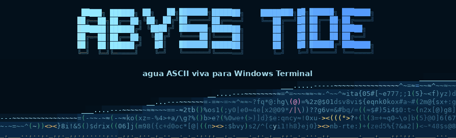
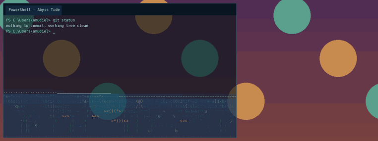
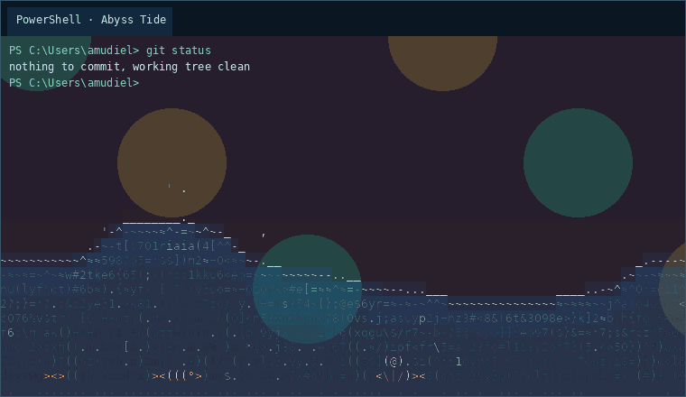
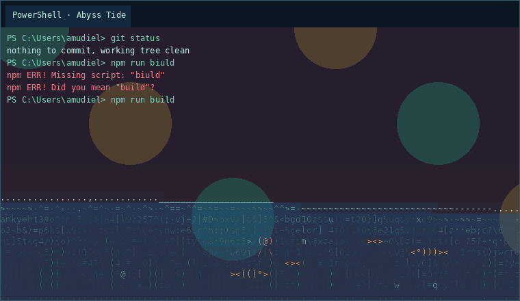
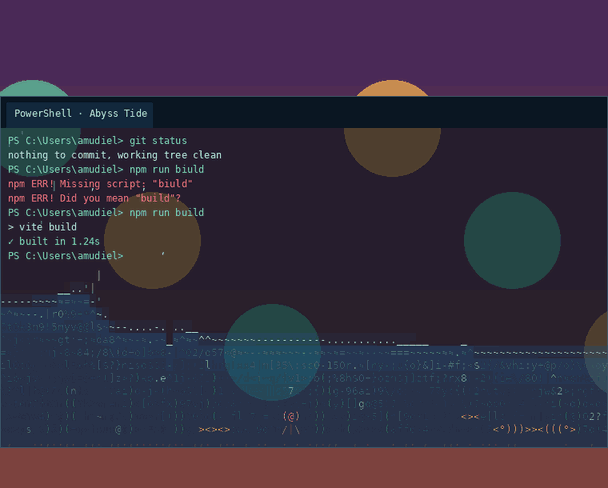
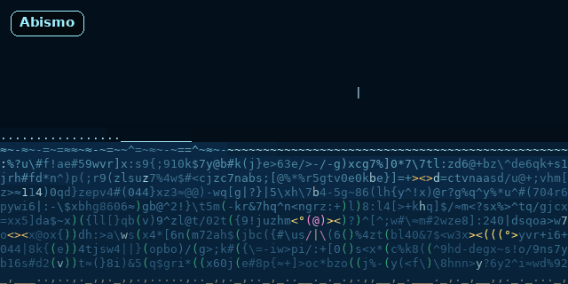
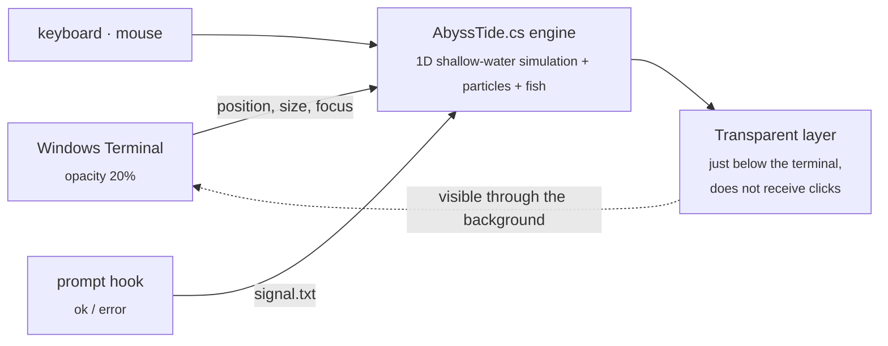

<div align="center">

<br>
A Windows Terminal background made of ASCII water that moves with you.<br>
Drag the window and the water crashes. Type and droplets fall. Run a command that fails and the sea turns red.
<br>


Install · What it does · Palettes · Settings · How it works
</div>
---
<a id="what-it-does"></a>
🌊 What it does
<table>
<tr>
<td width="50%" valign="top">
Move it
Drag the terminal and suddenly release it: the water lags behind, crashes into the wall, and splashes. Shake it to make waves. Give it a sharp pull downward and the water jumps.

</td>
<td width="50%" valign="top">
Type into it
Every keystroke drops a droplet, and Enter makes a splash. If a command fails, the water turns red and churns. If it succeeds, bubbles rise.

</td>
</tr>
<tr>
<td width="50%" valign="top">
Touch it
Move the cursor through the water and drag it around. The fish get startled and flee.

</td>
<td width="50%" valign="top">
Watch it come alive
It's a sea of characters that change faster where the waves are strongest. It has fish `><>` `<°)))><`, a jellyfish `(@)`, seaweed `)(`, and sand. It tilts toward the nearest edge of the screen.

</td>
</tr>
</table>
> [!NOTE]
> The animations are the actual simulation (`AbyssTide.cs`) rendered outside Windows. The terminal text is just a mockup.
<a id="palettes"></a>
🎨 Palettes
<div align="center">

</div>
	Palette	
🌌	Abyss	deep blue (default)
🏝️	Tropical	light turquoise
🌗	Day / night	shifts from Tropical to Abyss depending on the time of day
🌋	Lava	magma with sparks `^*%#`
☢️	Toxic	radioactive green with bubbles `oO0`
🟩	Matrix	binary rain `0101`
🌆	Synthwave	neon pink on violet
🎛️	Custom	your colors and characters
Switch palettes from the system tray icon without restarting anything.
<a id="install"></a>
📦 Install
```powershell
git clone https://github.com/BuddhaCodes/abyss-tide
cd abyss-tide
powershell -ExecutionPolicy Bypass -File .\install.ps1
```
Then restart Windows Terminal and open the PowerShell · Abyss Tide profile. If you want to use it all the time, set it as your default profile.
<details>
<summary><b>What the installer does</b></summary>
<br>
Copies everything to `%LOCALAPPDATA%\AbyssTide`. No administrator privileges required.
Adds the color scheme and two profiles through a Windows Terminal fragment, without touching your `settings.json`.
Adds a small hook to the end of your `profile.ps1`, in both Windows PowerShell and PowerShell 7, to enable the red-water effect. Works with oh-my-posh, Starship, and any other prompt.
Creates a Startup shortcut so it launches with Windows.
Launches it.
Option	Effect
`-NoShellHook`	leaves your profile untouched (no red water when a command fails)
`-NoAutostart`	does not launch with Windows
`-Uninstall`	stops it and removes everything, including the hook
If you prefer PowerShell 7 for the terminal profile, change its command line to `pwsh.exe`.
</details>
🖱️ System tray menu
Right-click the wave icon next to the clock:
```
Palette             ▸  Abyss · Tropical · Day/night · Lava · Toxic · Matrix · Synthwave · Custom
Sensitivity         ▸  Low · Normal · High · Chaos
Water level         ▸  Low · Medium · High · Overflowing
Fish                ▸  None · Few · Normal · School
─────────────────
✓ Typing droplets           ✓ Red water when a command fails
✓ Mouse ripples             Focus mode (dim while typing)
✓ Seafloor                   ✓ Eco mode
✓ Jellyfish
─────────────────
Test: failed command · Save these settings · Open settings · Pause · Exit
```
<a id="settings"></a>
⚙️ Settings
They are stored in `%LOCALAPPDATA%\AbyssTide\abyss-tide.config.json`. Changes are applied automatically when you save the file. If an error is found, a warning appears and the previous settings are kept.
<details>
<summary><b>All options</b></summary>
<br>
Key	Effect
`Palette`	`abyss` `tropical` `daynight` `lava` `toxic` `matrix` `synthwave` `custom`
`MoveSensitivity`	`2.0` = lots of splashing · `0.4` = calmer
`FillLevel`	how much water there is (`0.05`–`0.9`)
`Damping`, `Gravity`	how quickly it settles and how fast the waves move
`TiltAmount`	how much the water tilts depending on where the window is on the screen
`SprayAmount`, `IdleDrips`	splashes and droplets per second while the window is still
`Fish`, `Jellyfish`, `Seafloor`	fish per window, jellyfish, sand, and seaweed
`TypingDrops`, `MouseRipples`, `ShellSignals`	reactions to the keyboard, mouse, and commands
`FocusMode`, `FocusDim`, `FocusDelay`	dims the water while you type and restores it after a few seconds of inactivity
`EcoMode`, `EcoFps`	lowers FPS when the water is calm or the battery is below 25%
`CharMode`	`sea` (sea of characters) or `ramp` (dots based on density)
`BackgroundAlpha`, `WaterAlpha`	background and water opacity (increase `BackgroundAlpha` if text is hard to read)
`BackgroundColor` `SurfaceColor` `DeepColor` `FoamColor`	colors when using `Palette: custom`
`SeaChars`, `SurfaceChars`	characters when using `Palette: custom`; try `"01"`
`FontPx`, `FontFamily`	size and font of the water characters
`TopInsetPx`	height of the tab bar; the water starts below it
The final transparency combines two things: the profile's `opacity` in Windows Terminal and `BackgroundAlpha` in the config.
</details>
<a id="how-it-works"></a>
🔬 How it works
Windows Terminal shaders don't preserve state between frames or know where the window is, so a normal theme can't react to anything. Abyss Tide places the water behind the terminal:

Physics: shallow-water equations are calculated in the window's reference frame. Accelerating the window creates an opposing pseudo-force; dropping it reduces gravity and the water jumps.
No extra installation: Windows PowerShell 5.1 compiles the engine the first time using the compiler already included with Windows. After that, it starts instantly from the cached DLL.
Lightweight: rendering is entirely software-based, and Eco mode drops to 15 FPS when the water is calm.
Robust: works with multiple windows at once, monitors with different DPI settings, virtual desktops, and minimized windows.
<details>
<summary><b>Repository files</b></summary>
<br>
File	Description
`AbyssTide.cs`	engine: simulation, marine life, transparent layer, system tray menu
`abyss-tide.ps1`	launcher: compiles once, saves the DLL, and runs it
`abyss-tide.config.json`	default settings
`abyss-tide.fragment.json`	color scheme and profiles for Windows Terminal
`abyss-tide.hlsl`	fallback shader: animated water without interaction or a background process
`install.ps1`	installer and uninstaller
`docs/`	animations used in this README
</details>
🔒 Privacy
"Typing droplets" and Focus mode use a low-level keyboard hook. It only counts keystrokes when a Windows Terminal window is in the foreground. It only detects Enter and Backspace, and it does not save or send any keystrokes. If you disable both options, the hook is removed immediately. Some antivirus software may flag this type of hook.
In terminals opened as administrator, Windows does not allow a normal process to read keyboard input, so typing droplets won't appear there. Everything else works the same.
🧩 Bonus: matching tab bar
Fragments cannot include window themes. If you want a matching tab bar, paste this into your `settings.json`:
```jsonc
"theme": "Abyss Tide",
"themes": [
  {
    "name": "Abyss Tide",
    "window": { "applicationTheme": "dark" },
    "tabRow": { "background": "#06121EFF", "unfocusedBackground": "#06121EFF" },
    "tab":    { "background": "#0B2133FF", "unfocusedBackground": "#06121EFF", "showCloseButton": "hover" }
  }
]
```
🛟 Common issues
<details>
<summary><b>The water doesn't turn red when a command fails</b></summary>
<br>
Use Test: failed command in the system tray menu. If the water turns red, the engine is working and the hook is the problem.
Open a new tab: tabs that were already open don't load the hook.
Run `Get-EventSubscriber`; `PowerShell.OnIdle` should appear. If it doesn't, run `install.ps1` again.
</details>
<details>
<summary><b>The water is misaligned or covers the tabs</b></summary>
<br>
Adjust `TopInsetPx` in the config to match the height of your tab bar, measured at 100% scaling. The change applies when you save.
</details>
<details>
<summary><b>The text is hard to read</b></summary>
<br>
Increase `BackgroundAlpha` (for example, to `0.75`), lower `WaterAlpha`, or enable Focus mode to dim the water while you type.
</details>
<details>
<summary><b>I'd rather not have anything running in the background</b></summary>
<br>
Use the PowerShell · Abyss Tide (shader only) profile: it has shader-animated water, but no interaction or fish.
</details>
---
<div align="center">
<sub>Made with lots of water and a little physics · <code>~≈~≈~ ><> ~≈~≈~</code></sub>
</div>
