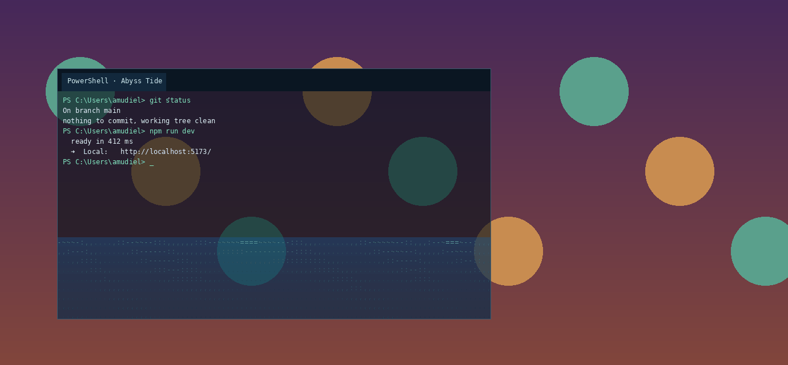

# Abyss Tide 🌊

Tema para Windows Terminal: fondo semitransparente con agua ASCII en 2D (vista lateral, como agua en una pecera) que **se mueve cuando mueves la ventana**. Si arrastras la terminal y la sueltas de golpe, el agua choca contra la pared y salpica. Si la sacudes, hace olas. Si das un tirón hacia abajo, salta. El agua es un mar de caracteres que cambian más rápido donde el agua está agitada.



> La vista previa es la simulación real (`AbyssTide.cs`) renderizada fuera de Windows. El texto de la terminal es de ejemplo.

## Contenido del repo

```
AbyssTide.cs              motor: simulación de agua + capa transparente detrás de la terminal
abyss-tide.ps1            lanzador (compila AbyssTide.cs con PowerShell 5.1 y lo ejecuta)
abyss-tide.config.json    ajustes editables
abyss-tide.fragment.json  esquema de color + perfiles para Windows Terminal
abyss-tide.hlsl           shader de respaldo (agua animada, sin reacción al movimiento)
install.ps1               instalador / desinstalador
```

## Cómo funciona

Los shaders de Windows Terminal no guardan estado entre fotogramas y no saben dónde está la ventana. Por eso un tema "normal" no puede reaccionar al movimiento. Abyss Tide tiene dos piezas:

| Pieza | Qué hace |
|---|---|
| `AbyssTide.cs` + `abyss-tide.ps1` | Motor de agua. Corre en segundo plano y detecta cada ventana de Windows Terminal. Coloca justo debajo de cada una una capa transparente que no recibe clics. Simula el agua con ecuaciones de aguas someras, en el marco de referencia de la ventana: al acelerar la ventana aparece una pseudo-fuerza opuesta. Lo compila el propio Windows PowerShell 5.1, así que no hay que instalar nada. |
| Perfil **PowerShell · Abyss Tide** | Usa el esquema de color Abyss Tide con `opacity: 20` y sin acrílico, así que el fondo de la terminal deja ver el agua que hay debajo. |
| `abyss-tide.hlsl` (opcional) | Shader de respaldo. Es agua ASCII animada, pero no reacciona al movimiento. Sirve para no ejecutar nada en segundo plano. Se usa con el perfil **PowerShell · Abyss Tide (solo shader)**. |

## Instalar

```powershell
# en la carpeta descomprimida
powershell -ExecutionPolicy Bypass -File .\install.ps1
```

El instalador:
- copia todo a `%LOCALAPPDATA%\AbyssTide`
- añade el esquema y los dos perfiles mediante un *fragment* de Windows Terminal, sin tocar tu `settings.json`
- crea un acceso directo en Inicio para que arranque con Windows (sáltalo con `-NoAutostart`)
- lo arranca

Después, reinicia Windows Terminal y abre el perfil **PowerShell · Abyss Tide**. Para usarlo siempre, márcalo como perfil predeterminado. Si prefieres PowerShell 7, cambia su línea de comandos a `pwsh.exe`.

Desinstalar: `.\install.ps1 -Uninstall`

## Ajustes

Edita `%LOCALAPPDATA%\AbyssTide\abyss-tide.config.json`. Luego sal desde el icono de la bandeja y vuelve a abrirlo, o ejecuta de nuevo `install.ps1`, que no sobrescribe tu config.

| Clave | Efecto |
|---|---|
| `MoveSensitivity` | 2.0 = salpica mucho; 0.4 = más calmado |
| `FillLevel` | cuánta agua hay (0.05–0.9) |
| `Damping` | qué tan rápido se calma |
| `SprayAmount`, `IdleDrips` | salpicaduras y gotas cuando está quieta |
| `BackgroundAlpha` | opacidad del fondo (sube si cuesta leer el texto) |
| `SurfaceColor`, `DeepColor`, `FoamColor`, `WaterAlpha` | colores del agua |
| `CharMode` | `sea` (mar de caracteres, por defecto) o `ramp` (puntos por densidad) |
| `SeaChars`, `SurfaceChars` | caracteres del interior y de la superficie; prueba `"01"` o katakana `"ｱｲｳｴｵｶｷｸｹｺ"` |
| `FontPx`, `FontFamily` | tamaño y fuente de los caracteres del agua |
| `TopInsetPx` | alto de la barra de pestañas; el agua empieza debajo |

La transparencia final combina dos cosas: el `opacity` del perfil en Windows Terminal y el `BackgroundAlpha` de la config. Con `opacity` en 0 el agua se ve más nítida, pero si el motor no está corriendo la terminal queda completamente transparente.

## Opcional: barra de pestañas a juego

Los fragments no pueden traer temas de ventana. Si quieres la barra a juego, pega esto en `settings.json`:

```jsonc
"theme": "Abyss Tide",
"themes": [
  {
    "name": "Abyss Tide",
    "window": { "applicationTheme": "dark" },
    "tabRow": { "background": "#06121EFF", "unfocusedBackground": "#06121EFF" },
    "tab":    { "background": "#0B2133FF", "unfocusedBackground": "#06121EFF", "showCloseButton": "hover" }
  }
]
```

## Requisitos y notas

- Windows 10 1703 o posterior / Windows 11, y Windows Terminal 1.12 o posterior (necesario para `opacity` sin acrílico).
- Usa poca CPU: la simulación es 1D, con una columna por carácter, y el dibujo es software puro a 60 fps.
- Funciona con varias ventanas de Terminal a la vez, monitores con distintos DPI, escritorios virtuales y ventanas minimizadas.
- En pantalla completa o maximizada sigue funcionando. Al redimensionar, el agua se redistribuye.
