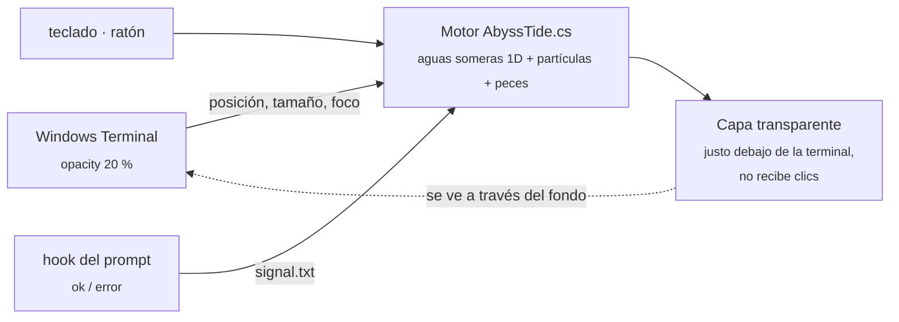

<div align="center">


<br>

**Un fondo para Windows Terminal hecho de agua ASCII que se mueve contigo.**<br>
Arrastra la ventana y el agua choca. Escribe y caen gotas. Falla un comando y el mar se tiñe de rojo.

<br>


[Instalar](#instalar) · [Qué hace](#que-hace) · [Paletas](#paletas) · [Ajustes](#ajustes) · [Cómo funciona](#como-funciona)

</div>

---

<a id="que-hace"></a>

## 🌊 Qué hace

<table>
<tr>
<td width="50%" valign="top">

### Muévela
Arrastra la terminal y suéltala de golpe: el agua se queda atrás, choca contra la pared y salpica. Si la sacudes, hace olas. Con un tirón hacia abajo, el agua salta.


</td>
<td width="50%" valign="top">

### Escríbele
Cada tecla deja caer una gota y Enter salpica. Si un comando **falla**, el agua se vuelve roja y se agita. Si sale bien, suben burbujas.


</td>
</tr>
<tr>
<td width="50%" valign="top">

### Tócala
Pasa el cursor por el agua y la arrastras. Los peces se asustan y huyen.


</td>
<td width="50%" valign="top">

### Mírala vivir
Es un mar de caracteres que cambian más rápido donde hay oleaje. Tiene peces `><>` `<°)))><`, una medusa `(@)`, algas `)(` y arena. Se inclina hacia el borde de la pantalla más cercano.


</td>
</tr>
</table>

> [!NOTE]
> Las animaciones son la simulación real (`AbyssTide.cs`) renderizada fuera de Windows. El texto de la terminal es de ejemplo.

<a id="paletas"></a>

## 🎨 Paletas

<div align="center">

</div>

| | Paleta | |
|---|---|---|
| 🌌 | **Abismo** | azul profundo (por defecto) |
| 🏝️ | **Tropical** | turquesa claro |
| 🌗 | **Día / noche** | pasa de Tropical a Abismo según la hora |
| 🌋 | **Lava** | magma con chispas `^*%#` |
| ☢️ | **Tóxico** | verde radiactivo con burbujas `oO0` |
| 🟩 | **Matrix** | lluvia binaria `0101` |
| 🌆 | **Synthwave** | rosa neón sobre violeta |
| 🎛️ | **Personalizada** | tus colores y tus caracteres |

Se cambian desde el icono de la bandeja, sin reiniciar nada.

<a id="instalar"></a>

## 📦 Instalar

```powershell
git clone https://github.com/BuddhaCodes/abyss-tide
cd abyss-tide
powershell -ExecutionPolicy Bypass -File .\install.ps1
```

Después, **reinicia Windows Terminal** y abre el perfil **PowerShell · Abyss Tide**. Si quieres usarlo siempre, márcalo como perfil predeterminado.

<details>
<summary><b>Qué hace el instalador</b></summary>

<br>

- Copia todo a `%LOCALAPPDATA%\AbyssTide`. No necesita permisos de administrador.
- Añade el esquema de color y dos perfiles mediante un [fragment](https://learn.microsoft.com/windows/terminal/json-fragment-extensions) de Windows Terminal, **sin tocar tu `settings.json`**.
- Añade un pequeño hook al final de tu `profile.ps1`, tanto en Windows PowerShell como en PowerShell 7, para el agua roja. Funciona con oh-my-posh, Starship y cualquier otro prompt.
- Crea un acceso directo en Inicio para que arranque con Windows.
- Lo arranca.

| Opción | Efecto |
|---|---|
| `-NoShellHook` | no toca tu perfil (sin agua roja al fallar un comando) |
| `-NoAutostart` | no arranca con Windows |
| `-Uninstall` | lo detiene y lo quita todo, incluido el hook |

Si prefieres PowerShell 7 en el perfil de la terminal, cambia su línea de comandos a `pwsh.exe`.

</details>

## 🖱️ Menú de la bandeja

Haz clic derecho en el icono de la ola, junto al reloj:

```
Paleta              ▸  Abismo · Tropical · Día/noche · Lava · Tóxico · Matrix · Synthwave · Personalizada
Sensibilidad        ▸  Baja · Normal · Alta · Caos
Nivel del agua      ▸  Bajo · Medio · Alto · Desbordado
Peces               ▸  Ninguno · Pocos · Normal · Banco
─────────────────
✓ Gotas al escribir          ✓ Agua roja si un comando falla
✓ Ondas con el ratón           Modo foco (atenuar al escribir)
✓ Fondo marino               ✓ Modo eco
✓ Medusa
─────────────────
Probar: comando fallido · Guardar estos ajustes · Abrir configuración · Pausar · Salir
```

<a id="ajustes"></a>

## ⚙️ Ajustes

Están en `%LOCALAPPDATA%\AbyssTide\abyss-tide.config.json`. **Los cambios se aplican solos al guardar el archivo.** Si tiene un error, aparece un aviso y se mantienen los ajustes anteriores.

<details>
<summary><b>Todas las opciones</b></summary>

<br>

| Clave | Efecto |
|---|---|
| `Palette` | `abyss` `tropical` `daynight` `lava` `toxic` `matrix` `synthwave` `custom` |
| `MoveSensitivity` | `2.0` = salpica mucho · `0.4` = más calmado |
| `FillLevel` | cuánta agua hay (`0.05`–`0.9`) |
| `Damping`, `Gravity` | qué tan rápido se calma y qué tan rápidas son las olas |
| `TiltAmount` | cuánto se inclina el agua según dónde esté la ventana en la pantalla |
| `SprayAmount`, `IdleDrips` | salpicaduras y gotas por segundo con la ventana quieta |
| `Fish`, `Jellyfish`, `Seafloor` | peces por ventana, medusa, arena y algas |
| `TypingDrops`, `MouseRipples`, `ShellSignals` | reacciones al teclado, al ratón y a los comandos |
| `FocusMode`, `FocusDim`, `FocusDelay` | atenúa el agua mientras escribes y la recupera tras unos segundos sin teclear |
| `EcoMode`, `EcoFps` | baja los fps con el agua en calma o la batería por debajo del 25 % |
| `CharMode` | `sea` (mar de caracteres) o `ramp` (puntos por densidad) |
| `BackgroundAlpha`, `WaterAlpha` | opacidad del fondo y del agua (sube `BackgroundAlpha` si cuesta leer) |
| `BackgroundColor` `SurfaceColor` `DeepColor` `FoamColor` | colores con `Palette: custom` |
| `SeaChars`, `SurfaceChars` | caracteres con `Palette: custom`; prueba `"01"` |
| `FontPx`, `FontFamily` | tamaño y fuente de los caracteres del agua |
| `TopInsetPx` | alto de la barra de pestañas; el agua empieza debajo |

La transparencia final combina dos cosas: el `opacity` del perfil en Windows Terminal y el `BackgroundAlpha` de la config.

</details>

<a id="como-funciona"></a>

## 🔬 Cómo funciona

Los shaders de Windows Terminal no guardan estado entre fotogramas y no saben dónde está la ventana, así que un tema normal no puede reaccionar a nada. Abyss Tide pone el agua **detrás** de la terminal:



- **Física:** son ecuaciones de aguas someras en el marco de referencia de la ventana. Acelerar la ventana genera una pseudo-fuerza opuesta; dejarla caer reduce la gravedad y el agua salta.
- **Sin instalar nada:** Windows PowerShell 5.1 compila el motor la primera vez con el compilador que ya trae Windows. Después arranca al instante desde la DLL guardada en caché.
- **Ligero:** el render es software puro y el modo eco baja a 15 fps cuando el agua está en calma.
- **Robusto:** funciona con varias ventanas a la vez, monitores con distinto DPI, escritorios virtuales y ventanas minimizadas.

<details>
<summary><b>Archivos del repo</b></summary>

<br>

| Archivo | Qué es |
|---|---|
| `AbyssTide.cs` | motor: simulación, vida marina, capa transparente, menú de bandeja |
| `abyss-tide.ps1` | lanzador: compila una vez, guarda la DLL y la ejecuta |
| `abyss-tide.config.json` | ajustes por defecto |
| `abyss-tide.fragment.json` | esquema de color y perfiles para Windows Terminal |
| `abyss-tide.hlsl` | shader de respaldo: agua animada sin interacción y sin proceso en segundo plano |
| `install.ps1` | instalador y desinstalador |
| `docs/` | animaciones de este README |

</details>

## 🔒 Privacidad

"Gotas al escribir" y el modo foco usan un hook de teclado de bajo nivel. **Solo cuenta pulsaciones cuando una ventana de Windows Terminal está en primer plano.** Solo distingue Enter y Retroceso, y no guarda ni envía ninguna tecla. Si desactivas ambas opciones, el hook se quita al momento. Algunos antivirus avisan de este tipo de hook.

En terminales abiertas como administrador, Windows no permite leer el teclado desde un proceso normal, así que ahí no caen gotas al escribir. El resto funciona igual.

## 🧩 Extra: barra de pestañas a juego

Los fragments no pueden traer temas de ventana. Si quieres la barra a juego, pega esto en tu `settings.json`:

```jsonc
"theme": "Abyss Tide",
"themes": [
  {
    "name": "Abyss Tide",
    "window": { "applicationTheme": "dark" },
    "tabRow": { "background": "#06121EFF", "unfocusedBackground": "#06121EFF" },
    "tab":    { "background": "#0B2133FF", "unfocusedBackground": "#06121EFF", "showCloseButton": "hover" }
  }
]
```

## 🛟 Problemas frecuentes

<details>
<summary><b>El agua no se pone roja cuando falla un comando</b></summary>

<br>

1. Usa **Probar: comando fallido** en el menú de la bandeja. Si el agua se pone roja, el motor funciona y el problema es el hook.
2. Abre una **pestaña nueva**: las pestañas que ya estaban abiertas no cargan el hook.
3. Ejecuta `Get-EventSubscriber`; debería aparecer `PowerShell.OnIdle`. Si no aparece, vuelve a ejecutar `install.ps1`.

</details>

<details>
<summary><b>El agua queda desalineada o tapa las pestañas</b></summary>

<br>

Ajusta `TopInsetPx` en la config al alto de tu barra de pestañas, medido a 100 % de escala. Se aplica al guardar.

</details>

<details>
<summary><b>Cuesta leer el texto</b></summary>

<br>

Sube `BackgroundAlpha` (por ejemplo a `0.75`), baja `WaterAlpha`, o activa el **modo foco** para que el agua se atenúe mientras escribes.

</details>

<details>
<summary><b>Prefiero no tener nada en segundo plano</b></summary>

<br>

Usa el perfil **PowerShell · Abyss Tide (solo shader)**: tiene agua animada por shader, pero sin interacción ni peces.

</details>

---

<div align="center">
<sub>Hecho con mucha agua y un poco de física · <code>~≈~≈~ ><> ~≈~≈~</code></sub>
</div>
